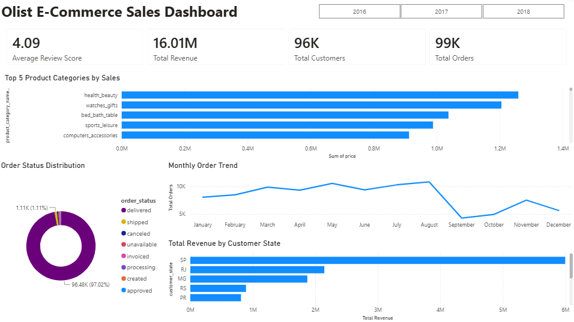

# Olist E-Commerce Sales Dashboard

An interactive Power BI dashboard that shows how a Brazilian online marketplace sells: how much, what, where, and how customers rate it.

**Status:** completed dashboard · public Olist dataset · the PDF export is included, the Power BI file is not

## Overview

The dashboard answers the first questions a commercial team asks of a marketplace: how big is it, what sells, where do customers live, and are orders getting delivered. It is built on the public [Olist Brazilian E-Commerce dataset](https://www.kaggle.com/datasets/olistbr/brazilian-ecommerce).

**Intended user:** a sales or category manager who wants a one-page view of marketplace performance and the ability to filter it by year.

## What it shows

| KPI | Value shown |
|---|---|
| Total revenue | 16.01M |
| Total orders | 99K |
| Total customers | 96K |
| Average review score | 4.09 |

Visuals:

- Top 5 product categories by sales (health and beauty, watches and gifts, bed and bath, sports and leisure, computers and accessories).
- Order status distribution. Delivered orders are 97.02% of the total.
- Monthly order trend.
- Total revenue by customer state, where São Paulo (SP) is the largest by a wide margin.

Interactions: a year slicer (2016, 2017, 2018), KPI cards that respond to it, and cross-filtering between visuals.

## What's in this repository

| File | What it is |
|---|---|
| [`Olist_Ecommerce_Sales_Dashboard.pdf`](Olist_Ecommerce_Sales_Dashboard.pdf) | A PDF export of the dashboard |
| [`docs/dashboard.png`](docs/dashboard.png) | The screenshot above |

## Tech stack

Power BI, SQL Server and DAX.

## Limitations and next steps

- The Power BI file (`.pbix`) and the SQL used to prepare the data are not in this repository, so the dashboard can be viewed but not rebuilt from here.
- The dashboard shows what happened, not why. For example, it does not explain the drop in orders late in the year.
- The revenue figure is shown without a currency label. Olist reports in Brazilian reais.
- Next: add the SQL and the data model, and add a delivery-time view to connect delivery performance to review scores.
